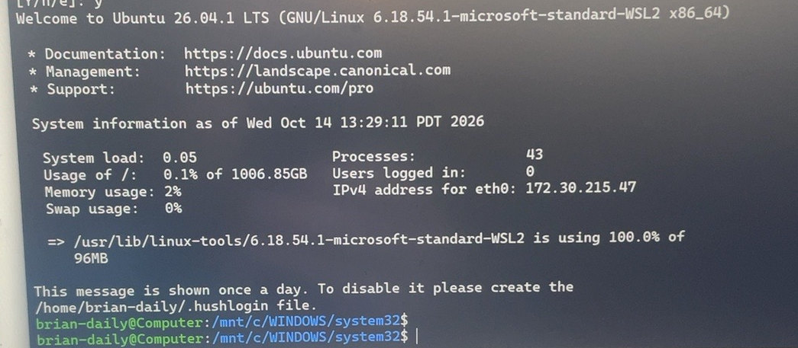
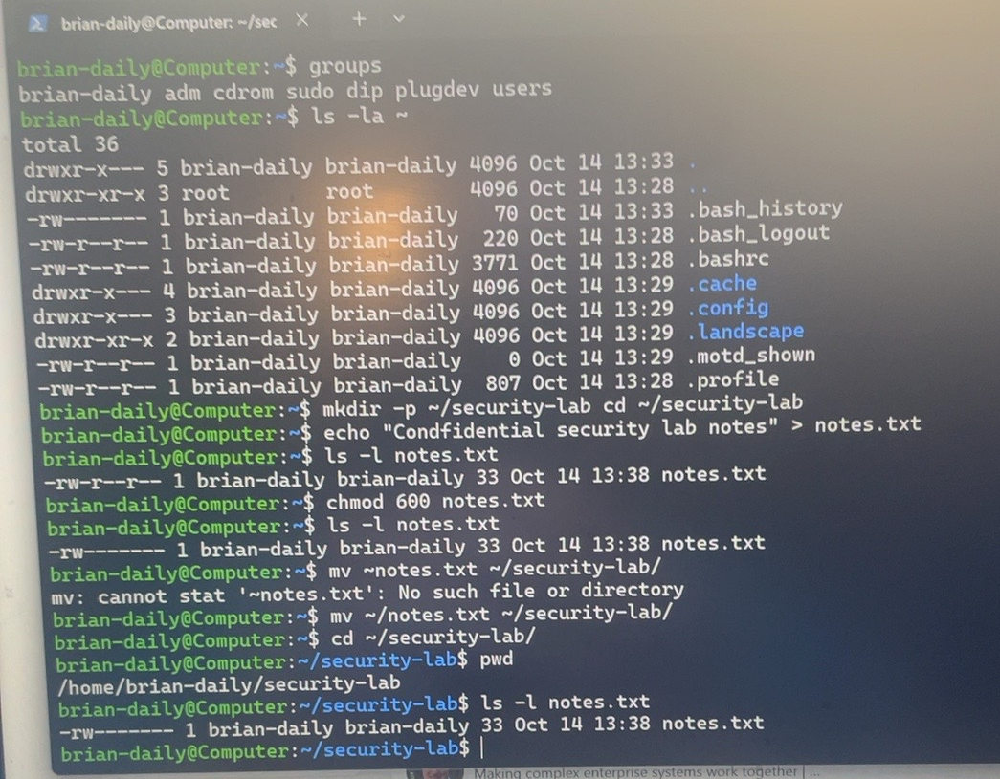
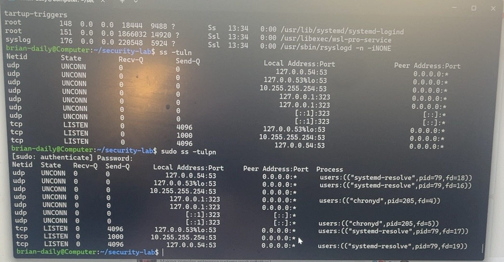
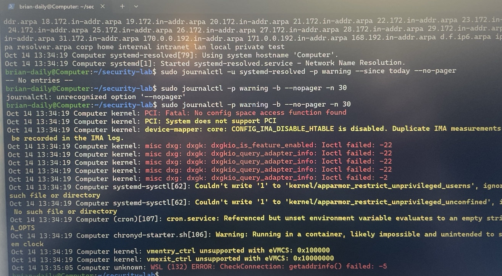
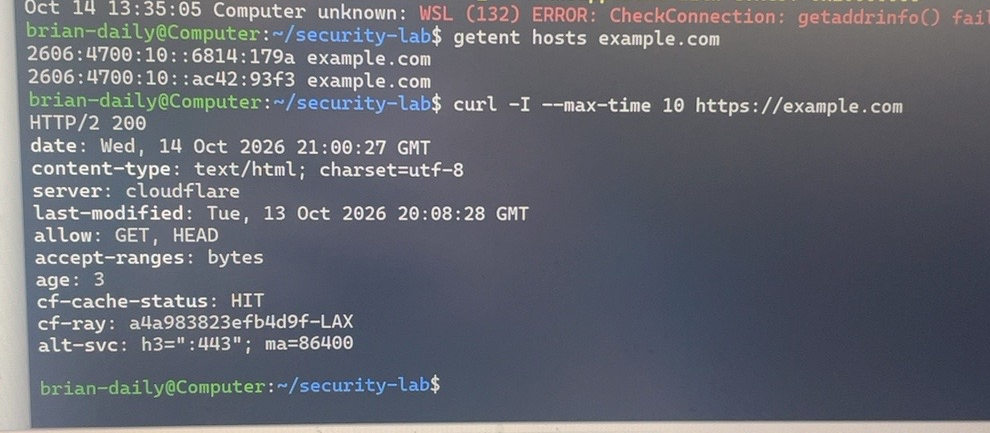

# Linux Security Baseline Assessment — Ubuntu on WSL 2

**Hands-on lab | October 14, 2026 | Introductory Linux administration and security diagnostics**

## Overview

I installed and configured an Ubuntu Linux environment using **Windows Subsystem for Linux (WSL 2)** on a Windows 11 laptop. I then performed a guided, introductory security-baseline exercise covering account privileges, file permissions, running processes, listening network sockets, system services, logs, DNS resolution, and HTTPS connectivity.

The goal was to establish a **repeatable investigation workflow**: observe system behavior, collect evidence, distinguish expected behavior from potential issues, and verify that a suspected issue still exists before changing configuration.

> **Scope:** These findings describe this Ubuntu WSL 2 instance at the time tested. This was not a comprehensive security audit, a vulnerability assessment, or an assessment of the Windows host, Raspberry Pi, or home network.

## Lab environment

| Component | Observed configuration |
|---|---|
| Host | Windows 11 laptop |
| Linux distribution | Ubuntu 26.04.1 LTS |
| Virtualization | WSL 2 |
| Linux kernel | `6.18.54.1-microsoft-standard-WSL2` |
| Linux shell | Bash |
| Administration and diagnostic tools | `sudo`, APT, `systemctl`, `ps`, `ss`, `journalctl`, `getent`, `curl` |

## Assessment workflow

The commands below document the areas investigated; some are condensed into a reproducible sequence rather than a literal command-by-command transcript.

### 1. Installation, updates, and service health

From PowerShell:

```powershell
wsl --list --verbose
wsl -d Ubuntu
# After updating Ubuntu, restart the WSL environment from PowerShell:
wsl --shutdown
wsl -d Ubuntu
```

From Ubuntu:

```bash
cd ~
pwd
sudo apt update && sudo apt upgrade -y
ps -p 1 -o comm=
systemctl is-system-running
```

**Observed:** Ubuntu launched on WSL 2; PID 1 was `systemd`, and after restarting WSL, `systemctl is-system-running` returned **`running`**. A service-bus communication warning had appeared during the initial package upgrade; the later service-health check succeeded.



### 2. User identity, group membership, and file access

```bash
whoami
id
groups
ls -la ~
mkdir -p ~/security-lab
# The practice file was created in the home directory first.
echo "Confidential security lab notes" > ~/notes.txt
ls -l ~/notes.txt
chmod 600 ~/notes.txt
mv ~/notes.txt ~/security-lab/
cd ~/security-lab
pwd
ls -l notes.txt
```

**Observed:** The regular Linux account was a member of the `sudo` group. I changed the test file from `-rw-r--r--` (**644**) to `-rw-------` (**600**), moved it to the lab directory, and verified the permissions remained in place. Under standard Unix discretionary permissions, the owner retained read/write access while group and other access was removed.



### 3. Running processes and listening sockets

```bash
ps aux | head -n 15
ss -tuln
sudo ss -tulpn
```

**Observed:** The process list included expected Linux services such as `systemd-journald`, `systemd-resolved`, `cron`, and `rsyslogd`. The socket review identified:

| Port / protocol | Process identified | Interpretation |
|---|---|---|
| 53 / TCP and UDP | `systemd-resolved` for the visible assigned sockets | DNS resolution service |
| 323 / UDP | `chronyd` | Local time-service control sockets |
| 22 / TCP | No listener observed | No SSH listener in this snapshot |

The addresses included loopback addresses and a WSL-related `10.255.255.254` address. This output **does not independently establish** whether any port is reachable from the Windows host or the wider network.



### 4. Service and system log investigation

```bash
sudo journalctl -u systemd-resolved -n 20 --no-pager
sudo journalctl -u systemd-resolved -p warning --since today --no-pager
sudo journalctl -p warning -b --no-pager -n 30
```

**Observed:** The DNS service journal contained ordinary startup and shutdown events. Its warning-or-higher query for the selected period returned **`-- No entries --`**.

The system-wide warning review did return entries, including PCI-related and virtual graphics messages, messages about unavailable kernel/AppArmor settings, a container time-synchronization warning, and a **WSL `CheckConnection: getaddrinfo() failed: -5`** error. Some warnings appear consistent with virtualization constraints; their precise causes were not proven during this exercise.



### 5. DNS and HTTPS verification

```bash
getent hosts example.com
curl -I --max-time 10 https://example.com
```

**Observed:** `getent` returned IPv6 addresses for `example.com`, demonstrating successful hostname resolution at the time of testing. The HTTPS request completed with **`HTTP/2 200`**. These successful tests show that the earlier `getaddrinfo()` warning was **not preventing these operations at test time**; they do not identify its original cause or prove that connectivity is always reliable.



## Findings summary

| Area | Finding | Status |
|---|---|---|
| WSL installation | Ubuntu 26.04.1 LTS launched under WSL 2 | Verified |
| Service manager | `systemd` present; overall status `running` after restart | Verified |
| File access | Practice file restricted from mode 644 to 600 | Verified |
| Local sockets | DNS and Chrony sockets identified; no SSH listener observed | Observed snapshot |
| DNS service warnings | No warning-or-higher entries for the selected period | Limited clean result |
| System journal | Multiple WSL/virtualization-related warnings visible | Reviewed; not all explained |
| WSL DNS error | One `getaddrinfo()` error appeared in logs | Cause unresolved |
| DNS and HTTPS | Hostname resolved; remote server returned HTTP 200 | Working at test time |

## Key takeaways

- System logs can contain warnings that require **context and verification**, not immediate remediation.
- A running service, an open socket, and an externally reachable port are **different concepts**.
- Linux permissions can be checked before and after a change to demonstrate that a security control took effect.
- A historical DNS error does not necessarily mean DNS is currently broken; testing provides stronger evidence about present behavior.
- A baseline is useful because future observations can be compared against a documented starting point.

## Limitations and follow-up

This introductory exercise did **not** verify OS hardening against a benchmark, scan for vulnerabilities, confirm external network exposure, test IPv4 connectivity separately, perform threat hunting, deploy a SIEM, or analyze the host Windows security configuration. No finding here establishes that the system is free of compromise.

Possible next steps include collecting a baseline into a timestamped text report, comparing repeated snapshots, checking DNS resolver configuration, examining relevant warnings in more detail, and adding a short Bash script to automate **read-only** evidence collection.

## Portfolio skills demonstrated

**Linux fundamentals · Ubuntu · WSL 2 · APT package management · file permissions · systemd · process inspection · network socket inspection · basic log analysis · DNS and HTTPS troubleshooting**

The work represents **foundational, guided hands-on experience**, not an advanced security audit or production incident response investigation.

## Related portfolio projects

- [Cybersecurity Virtual Lab Environment](https://github.com/bemerson24/cybersecurity-virtual-lab-environment) — Windows and Kali Linux virtualization with host-only networking validation still in progress.
- [Security Operations Analyst Learning Roadmap](https://github.com/bemerson24/cybersecurity-virtual-lab-environment/blob/main/docs/security-operations-analyst-roadmap.md) — planned progression from networking and Security+ through Windows logs, KQL/Sentinel, endpoint/identity investigations, and incident response.
- [Raspberry Pi Pi-hole](https://github.com/bemerson24/raspberry-pi-pihole) — DNS filtering and a preliminary smart-TV DNS investigation.
- [Raspberry Pi 400 — OctoPi 3D Printer Management](https://github.com/bemerson24/raspberry-pi-octopi) — retrospective documentation of a 2020–2024 hardware/software project.

These are separate projects with separate evidence and scope; results from one should not be generalized to another.

---

*Screenshots are cropped from the original hands-on lab session. Review screenshot content and local usernames/host metadata before publishing publicly.*
